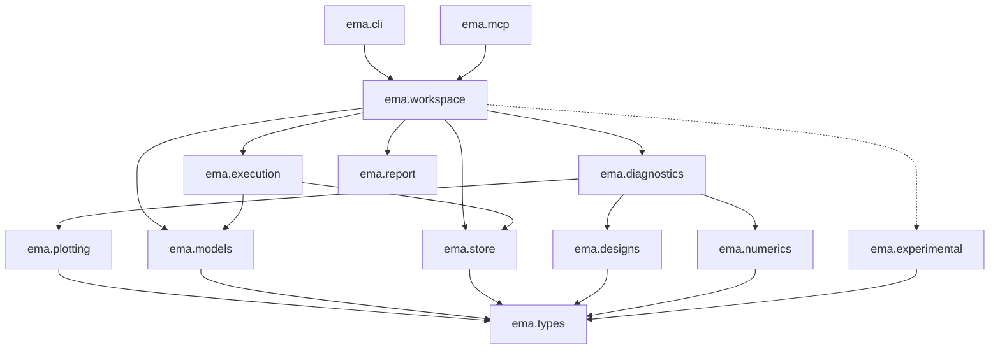

# EMA v2 API: packages, layers, and modules

**Status:** draft. **Updated:** 2026-09-28. (Formerly `api_spec_draft.md`.)
**Related:** `../notes/v1/ema-redesign.md` (the objects, designs, and diagnostics this follows),
`data_model.md` (the store's functions come from its §7 and §8),
`../notes/v1/lessons_learned_2026-09-27.md` and `../notes/v1/lessons_learned_answers_2026-09-27.md` (§6, the
layered interface).

> **How to use this document.** It lists every package and module in v2, what each is for, which layer it
> belongs to, and its public names, with signatures. Signatures are Python stubs (`...` for the body). Edit
> freely: rename, delete, and move things. Items marked **Decide:** are open choices, each with a default
> suggestion. Once a module's entry is settled, it is the spec that the module's code and contract tests are
> written against.
>
> **Words.** "API" here has its ordinary meaning: the public names and signatures of any module, and of the
> package as a whole. The *workspace layer* (`ema.workspace`, layer 4) is one particular module: the front door
> that users, the CLI, and the MCP server call. It runs the lower layers' functions in the right order, and
> enforces the rules that span several of them (budget before running, approval before new runs).
>
> **Conventions in the stubs:**
> - `np.ndarray` shapes are written in comments: `(n, d)` means n points in d inputs;
> - every public class is a frozen dataclass unless marked otherwise;
> - nothing public returns a bare `dict`.

---

## 1. The layers

Each layer may import only from layers below it. The numbers are the rule: a module in layer *k* imports only
from layers `< k`, and from its own package.

| Layer | Packages | What it holds | Side effects |
|---|---|---|---|
| 0: types | `ema.types` | the domain's data classes and errors: parameters, model specs, boxes, designs, runs, results | none |
| 1: numerics | `ema.numerics`, `ema.designs` | pure functions: bases, fits, intervals; design generators | none |
| 2: adapters | `ema.models`, `ema.store` | running a model; the database and blob store | processes, files |
| 3: services | `ema.execution`, `ema.diagnostics`, `ema.plotting`, `ema.report` | running a design with the cache; computing, plotting, and reporting a diagnostic | files (figures) |
| 4: workspace | `ema.workspace` | the front door: the few functions users call; the one place that orchestrates | through layers 2–3 |
| 5: interfaces | `ema.cli`, `ema.mcp` | presentation only: parse arguments, call the workspace, format the result | terminal, stdio |
| side: experimental | `ema.experimental` | interpretation and advice, read from stored results | none |

The rules:
- **Presentation only above layer 4.** `ema.cli` and `ema.mcp` contain no logic. If they need a computation,
  it goes into `ema.workspace`, so the notebook, the CLI, and the agent all get it.
- **Nothing imports `ema.experimental`** except `ema.workspace` (to offer it) and the interfaces. The main report can't
  reach interpretation, because it can't import it.
- **Layers 0–1 never do I/O.** No files, no printing, no clock, no randomness without a seed argument.
- **No LLM SDK anywhere.** `ema.mcp` speaks the Model Context Protocol; the model belongs to the host.
- **Enforced by a test:** import-linter contracts in `pyproject.toml` (§11), run in the fast test tier.



---

## 2. Directory layout

```text
src/ema/
  __init__.py                 re-exports the public names: open_workspace, Workspace, the result types
  types/                      layer 0
    __init__.py
    parameters.py             ModelParameter, Scale, Constraint
    spec.py                   ModelSpec, OutputSpec, Interface
    box.py                    Box
    design.py                 Design, DesignRequest
    runs.py                   RunStatus, RunRecord, RunBatch
    results.py                Estimate, Result, Note, Figure, ReportSection
    summaries.py              ModelSummary, DiagnosticSummary, ResultSummary, ModelProposal
    requests.py               Budget, ApprovalRequest, Approver, CostEstimate
    errors.py                 EMAError and its subclasses
  numerics/                   layer 1
    __init__.py
    legendre.py               the Legendre basis and its Vandermonde matrix
    multiindex.py             total-degree and tensor index sets
    fitting.py                least squares, cross-validation, residuals
    intervals.py              bootstrap and convergence intervals
    fourier.py                discrete Fourier transform of evenly spaced samples
    hashing.py                input_hash, version_hash helpers
  designs/                    layer 1
    __init__.py               the design registry
    uniform.py                UniformDesign
    convergent.py             ConvergentDesign
    line.py                   LineDesign, CoordinateLines, RandomLines
    point.py                  PointDesign
    plane.py                  PlaneDesign (TODO)
  models/                     layer 2
    __init__.py               load_model(spec) -> Model
    base.py                   Model (protocol)
    python_function.py        PythonFunctionModel
    command_line.py           CommandLineModel (input-deck template, subprocess)
    parsers.py                output parsers for command-line models
    sandbox.py                the isolated child process: scrubbed environment, timeout, limits
    _worker.py                the child's side of the protocol (JSON lines)
  store/                      layer 2 (from docs/design/data_model.md)
    __init__.py
    schema.sql                the CREATE TABLE statements
    records.py                one record class per table
    store.py                  Store: one function per write (W…) and read (Q…) operation
    blobs.py                  the content-addressed blob store for large arrays
    migrations.py
  execution/                  layer 3
    __init__.py
    scheduler.py              Executor protocol; SerialExecutor, ProcessExecutor
    runner.py                 run_design: the cache, batching, and recording
  diagnostics/                layer 3
    __init__.py               the diagnostic registry
    base.py                   Diagnostic (protocol), DiagnosticSpec, the shared prechecks
    point_run.py
    scatter.py
    coordinate_lines.py
    random_lines.py
    linear_model.py
    polynomial_model.py
  plotting/                   layer 3
    __init__.py
    figures.py                new_figure, save (with its data card), axis_label
    style.py                  palette, colour maps, how failed runs are drawn
  report/                     layer 3
    __init__.py
    render.py                 render a Report to Markdown
    sections.py               the header, results, figures, runs, provenance sections
  workspace.py                layer 4: Workspace and open_workspace
  experimental/               side package
    __init__.py
    interpret.py              interpret(result) -> Interpretation
  cli.py                      layer 5
  mcp.py                      layer 5 (the MCP server)
tests/
  contracts/                  one module of check_* functions per interface (§10)
  unit/                       layers 0–1: pure, fast
  integration/                layers 2–4
  slow/                       end-to-end, marked slow
docs/                         guides, glossary, one spec per diagnostic, decisions/
```

**Decide:** `types/` as a package of small modules (above), or one `types.py`. Suggested: the package, since
`results.py` will grow with the diagnostics.

---

## 3. Layer 0: `ema.types`

The vocabulary of the whole application. Pure data: no I/O, no NumPy randomness, nothing that imports from
another EMA package.

### `types/parameters.py`

```python
class Scale(Enum):
    LINEAR = "linear"
    LOG = "log"          # designs spread the parameter evenly in its logarithm

@dataclass(frozen=True)
class Constraint:
    """A condition every point must meet, such as positivity."""
    kind: str            # "positive" | "nonnegative" | "integer" | …   Decide: the list
    ...

@dataclass(frozen=True)
class ModelParameter:
    name: str
    units: str
    description: str
    nominal: float
    scale: Scale = Scale.LINEAR
    constraint: Constraint | None = None
```

**Decide:**
- v1 and its glossary call these *inputs*, and the ranges together the *input box*; `../notes/v1/ema-redesign.md` calls
  them `ModelParameter` and *ranges*. Pick one pair of words, and update the glossary.
- Suggested: keep `ModelParameter` for the class, and call the ranges a `Box`.
- Separately, decide whether fixed parameters (ones that are not design variables; your 2026-09-23 question)
  are `ModelParameter`s with no range, or a separate `fixed` mapping on the spec.

### `types/spec.py`

```python
class Interface(Enum):
    PYTHON_FUNCTION = "python_function"
    COMMAND_LINE = "command_line"

@dataclass(frozen=True)
class OutputSpec:
    name: str
    units: str
    description: str
    shape: tuple[int, ...] = ()      # () for a scalar; (200,) for a curve; (64, 64) for a field

@dataclass(frozen=True)
class ModelSpec:
    name: str
    description: str
    interface: Interface
    parameters: tuple[ModelParameter, ...]
    outputs: tuple[OutputSpec, ...]
    execution: Mapping[str, Any]      # interface-specific: the callable, or the command and template
    parallel: bool = False            # True: the model takes a whole batch of points in one call
    typical_run_time_s: float | None = None   # "speed of evaluation"

    @classmethod
    def load(cls, path: Path) -> "ModelSpec": ...     # reads model.json; relative paths resolve against it
    def save(self, directory: Path) -> Path: ...
    def tracked_files(self) -> dict[str, Path]: ...   # the files whose contents make the version
```

The version hash is computed by `ema.numerics.hashing.version_hash(spec)`, not stored on the spec, so the
spec stays pure data.

**Decide:**
- Is `execution` a dict, or one dataclass per interface (`PythonExecution`, `CommandLineExecution`)?
  Suggested: dataclasses, so they are validated when loaded.

### `types/box.py`

```python
@dataclass(frozen=True)
class Box:
    """The ranges a design samples, one [low, high] per parameter, and each parameter's scale."""
    ranges: Mapping[str, tuple[float, float]]
    scales: Mapping[str, Scale]

    @classmethod
    def around_nominal(cls, spec: ModelSpec, relative: float) -> "Box": ...
    def to_unit(self, X: np.ndarray) -> np.ndarray: ...     # (n, d) → [-1, 1]^d, in log for log-scale parameters
    def from_unit(self, U: np.ndarray) -> np.ndarray: ...
    def names(self) -> tuple[str, ...]: ...
```

A zero-width range means "held at this value": the design varies the other parameters, and figures skip it
(`../notes/v1/ema-redesign.md`: "Range with no length means no plot").

### `types/design.py`

```python
@dataclass(frozen=True)
class Design:
    """Points to run: the output of a design generator, before any run."""
    kind: str                         # "uniform", "line", …
    box: Box
    X: np.ndarray                     # (n, d), in parameter units
    replicate: np.ndarray             # (n,), 0 unless points are deliberately repeated
    params: Mapping[str, Any]         # the generator's parameters, including its seed
    meta: Mapping[str, Any]           # e.g. each line's anchor and direction

    def __len__(self) -> int: ...
```

### `types/runs.py`

```python
class RunStatus(Enum):
    OK = "ok"
    FAILED = "failed"
    TIMEOUT = "timeout"
    INVALID_INPUT = "invalid_input"

@dataclass(frozen=True)
class RunRecord:
    run_id: str
    x: np.ndarray                     # (d,)
    outputs: Mapping[str, float | np.ndarray | None]   # None where that output failed
    status: RunStatus
    error: str | None                 # why it failed: the model's own message where available
    wall_time_s: float | None
    cached: bool                      # True if it came from the cache, not a new run

@dataclass(frozen=True)
class RunBatch:
    """The runs of one design, in design order."""
    design: Design
    records: tuple[RunRecord, ...]

    def y(self, qoi: str) -> np.ndarray: ...   # (n,) for a scalar output; NaN where a run failed
    @property
    def n_failed(self) -> int: ...
    @property
    def n_new(self) -> int: ...
```

### `types/results.py`

```python
@dataclass(frozen=True)
class Estimate:
    """A number with its interval, and how the interval was made."""
    value: float
    interval: tuple[float, float] | None      # None when the method gives none
    method: str | None                        # "bootstrap", "convergence", "cross-validation", …
    level: float | None = None                # e.g. 0.95

@dataclass(frozen=True)
class Note:
    """A caveat about the data: failed runs, too few runs, a constant output."""
    code: str                                 # "failed_runs", "too_few_runs", "constant_output", …
    text: str

@dataclass(frozen=True)
class Figure:
    path: Path                                # the image
    card: Mapping[str, Any]                   # the data card: axes, labels, limits, plotted numbers

@dataclass(frozen=True)
class Result:
    """What a diagnostic computed. Numbers only: no verdicts."""
    diagnostic: str
    qoi: str
    values: Mapping[str, Estimate | Mapping[str, Estimate]]   # e.g. {"r2": …, "coefficients": {"a": …}}
    n_runs: int
    n_usable: int
    notes: tuple[Note, ...]
    figures: tuple[Figure, ...] = ()

@dataclass(frozen=True)
class ReportSection:
    """One section of a report. Here, not in ema.report, so diagnostics can build one without importing the renderer."""
    title: str
    markdown: str                                  # numbers formatted by EMA; no verdicts
    figures: tuple[Figure, ...] = ()
```

### `types/summaries.py`

Short records for listings, and a proposed model before approval.

```python
@dataclass(frozen=True)
class ModelSummary:
    name: str
    version_id: str
    n_parameters: int
    outputs: tuple[str, ...]
    registered_at: datetime

@dataclass(frozen=True)
class DiagnosticSummary:
    name: str
    description: str
    params: Mapping[str, tuple[Any, str]]          # name → (default, help)

@dataclass(frozen=True)
class ResultSummary:
    result_id: str
    model: str
    diagnostic: str
    qoi: str
    n_runs: int
    n_failed: int
    created_at: datetime

@dataclass(frozen=True)
class ModelProposal:
    spec: ModelSpec
    files: Mapping[str, str]                       # path → full text of every file that would be written
    approval: ApprovalRequest                      # what saving it will ask
```

**Decide:**
- Your glossary term for intervals: "variation intervals", against confidence or credible intervals. It
  decides the name of `Estimate.interval`, and the words in reports.

### `types/requests.py`

```python
@dataclass(frozen=True)
class Budget:
    max_runs: int | None = None
    max_seconds: float | None = None

@dataclass(frozen=True)
class CostEstimate:
    n_points: int
    n_cached: int
    n_new: int
    est_seconds: float | None                  # from the model's typical run time or its stored runs
    within_budget: bool | None

@dataclass(frozen=True)
class ApprovalRequest:
    """What the analyst is asked before anything runs or is saved."""
    action: str                                # "run", "save_model", …
    summary: str                               # one sentence, rendered by EMA
    details: Mapping[str, Any]                 # the command, the files, the cost

class Approver(Protocol):
    def __call__(self, request: ApprovalRequest) -> bool: ...
```

### `types/errors.py`

```python
class EMAError(Exception): ...                 # base; every error EMA raises on purpose
class SpecError(EMAError): ...                 # a model spec that doesn't validate
class DesignTooLarge(EMAError): ...            # refused before the design is built
class BudgetExceeded(EMAError): ...            # refused before anything runs
class ApprovalDeclined(EMAError): ...
class ModelChanged(EMAError): ...              # the model's files changed during a diagnostic
class NotFound(EMAError): ...                  # no such model, design, or result
```

Each error carries `retryable: bool` as a class attribute, so the interfaces can say whether trying again can
help.

---

## 4. Layer 1: `ema.numerics` and `ema.designs`

Pure functions of arrays. Everything random takes a `seed` or a `np.random.Generator`.

### `numerics/legendre.py` and `numerics/multiindex.py`

```python
def total_degree(d: int, degree: int) -> np.ndarray: ...          # (m, d) multi-indices, |α| ≤ degree
def tensor(d: int, degree: int) -> np.ndarray: ...
def n_terms(d: int, degree: int) -> int: ...                        # C(d + degree, degree), without building
def vandermonde(U: np.ndarray, indices: np.ndarray) -> np.ndarray: ...   # (n, m), orthonormal on [-1, 1]^d
def gradient(U: np.ndarray, indices: np.ndarray, coef: np.ndarray) -> np.ndarray: ...   # (n, d)
```

### `numerics/fitting.py`

```python
@dataclass(frozen=True)
class Fit:
    coef: np.ndarray
    residuals: np.ndarray
    r2: float
    cv_r2: float | None
    cv_folds: np.ndarray | None

def least_squares(A: np.ndarray, y: np.ndarray, *, folds: int = 5, seed: int = 0) -> Fit: ...
def min_points(n_terms: int) -> int: ...                           # the fewest runs a fit accepts
```

### `numerics/intervals.py`

```python
def bootstrap(stat: Callable[[np.ndarray], np.ndarray], n: int, *, n_resamples: int, level: float,
              seed: int) -> tuple[np.ndarray, np.ndarray]: ...    # (lo, hi) for each statistic
def convergence_interval(values_by_level: Sequence[np.ndarray], alpha: float) -> tuple[float, float]: ...
```

**Decide:** the one uncertainty method each diagnostic uses (your `../notes/v1/diagnostic-notes.md`: bootstrap,
refinement and convergence, cross-validation, held-out error).

### `numerics/fourier.py` and `numerics/hashing.py`

```python
def spectrum(y: np.ndarray) -> tuple[np.ndarray, np.ndarray]: ...  # (frequencies, amplitudes) of evenly spaced samples

def input_hash(x: Mapping[str, float]) -> str: ...                 # exact floats, independent of key order
def version_hash(spec: ModelSpec) -> str: ...                      # the spec (without its location) and its tracked files
```

`version_hash` reads files, which breaks layer 1's no-I/O rule. **Decide:** move it to `ema.models.base`, or
accept this one exception. Suggested: move it.

### `designs/`

A design generator is a function from a box and parameters to a `Design`, plus a closed-form `size`
with the same parameters. Each module registers its generators by name, as `DesignGenerator`s. The stubs
below show the call; each also has its `size`.

```python
# designs/__init__.py
def get(kind: str) -> DesignGenerator: ...
def names() -> tuple[str, ...]: ...

class DesignGenerator(Protocol):
    name: str
    def size(self, box: Box, **params) -> int: ...          # closed form: refuses a huge request before building it
    def __call__(self, box: Box, **params) -> Design: ...

# designs/uniform.py
def uniform(box: Box, n: int, seed: int = 0) -> Design: ...
    # the first n points of one seeded stream, so a smaller design is a subset of a larger one

# designs/convergent.py
def convergent(box: Box, n_min: int, alpha: float, level: int, seed: int = 0) -> Design: ...
    # nested uniform designs of n_min · alpha^k points, k = 0..level

# designs/line.py
def line(box: Box, anchor: Mapping[str, float], direction: Mapping[str, float], n: int) -> Design: ...
def coordinate_lines(box: Box, n: int, anchor: Mapping[str, float] | None = None) -> Design: ...
def random_lines(box: Box, m: int, n: int, seed: int = 0) -> Design: ...

# designs/point.py
def point(box: Box, x: Mapping[str, float], repeats: int = 0) -> Design: ...

# designs/plane.py
def plane(...) -> Design: ...          # TODO
```

**Decide:**
- Does `scipy.stats.qmc` (Sobol, Halton, Latin hypercube) replace or sit beside `uniform`?
- Are quadrature grids and sparse grids in scope (your "Integration grids?")?

---

## 5. Layer 2: `ema.models` and `ema.store`

### `models/base.py`

```python
class Model(Protocol):
    spec: ModelSpec
    version_id: str                                  # "name@hash"
    def evaluate(self, X: np.ndarray, replicate: np.ndarray) -> list[RunRecord]: ...
        # never raises for a bad point: a failure is a record with status and error
    def close(self) -> None: ...                     # stops any child process
```

### `models/__init__.py`, `python_function.py`, `command_line.py`, `parsers.py`, `sandbox.py`

```python
def load_model(spec: ModelSpec) -> Model: ...        # chooses the class from spec.interface

class PythonFunctionModel:        # Model; calls f(**x) or, with spec.parallel, f(X) once per batch
    ...
class CommandLineModel:           # Model; renders the deck, runs the command in a run directory, parses outputs
    ...
def parse(kind: str, run_dir: Path, settings: Mapping[str, Any]) -> dict[str, float | np.ndarray]: ...
class Sandbox:                    # the isolated child: scrubbed environment, stdin from /dev/null, timeout, limits
    def call(self, request: Mapping[str, Any], timeout_s: float) -> Mapping[str, Any]: ...
```

**Decide:** which output parsers v2 starts with (v1 had five kinds), and whether Python models are isolated
by default.

### `store/`

The store's public functions are exactly the write (W…) and read (Q…) operations of
`data_model.md` once it is filled in. Likely ones:

```python
class Store:
    @classmethod
    def open(cls, workspace: Path, *, read_only: bool = False) -> "Store": ...
    # writes
    def register_model(self, spec: ModelSpec, version_id: str) -> str: ...           # W1
    def record_design(self, design: Design, model_id: str) -> str: ...               # W2
    def record_runs(self, model_id: str, records: Sequence[RunRecord], design_id: str | None) -> None: ...  # W3
    def record_result(self, design_id: str, result: Result, provenance: Mapping[str, Any]) -> str: ...     # W4
    def record_approval(self, request: ApprovalRequest, answer: bool, source: str) -> None: ...            # W5
    # reads
    def cached_runs(self, model_id: str, keys: Sequence[tuple[str, int]]) -> dict[tuple[str, int], RunRecord]: ...  # Q1
    def get_result(self, result_id: str) -> Result: ...
    def list_results(self, *, model_id: str | None = None, qoi: str | None = None) -> list[ResultSummary]: ...
    def runs_used(self, design_ids: Sequence[str]) -> int: ...                        # for budgets
```

---

## 6. Layer 3: services

### `execution/scheduler.py`

```python
class Executor(Protocol):
    workers: int
    def map(self, fn: Callable, batches: Sequence[Any]) -> Iterator[Any]: ...   # yields as batches finish

class SerialExecutor: ...          # for tests and debugging
class ProcessExecutor: ...         # a pool of worker processes; a crashed worker fails only its runs
```

### `execution/runner.py`

```python
def run_design(model: Model, design: Design, store: Store, executor: Executor, *,
               design_id: str, on_progress: Callable[[int, int], None] | None = None) -> RunBatch: ...
    # looks up the cache (Q1), runs only the new points (all at once if the model is parallel),
    # records them in batches (W3), and returns every run in design order

def price(model: Model, design: Design, store: Store, budget: Budget | None) -> CostEstimate: ...
```

### `diagnostics/base.py`

Each diagnostic follows your five-row table: *User provides*, *Design*, *Compute*, *Plots*, *Report*.

```python
class Diagnostic(Protocol):
    name: str
    description: str
    Params: type                                   # a dataclass: what the user provides, with defaults and help
    min_runs: Callable[[Params, int], int]         # the fewest usable runs for any claim, given d

    def design(self, box: Box, params: Params) -> Design: ...                  # Design
    def compute(self, batch: RunBatch, qoi: str, params: Params) -> Result: ... # Compute (numbers and intervals)
    def plots(self, result: Result, batch: RunBatch, outdir: Path) -> tuple[Figure, ...]: ...   # Plots
    def report(self, result: Result) -> ReportSection: ...                     # Report (from numbers only)

def precheck(y: np.ndarray, min_runs: int) -> tuple[np.ndarray, tuple[Note, ...]]: ...
    # the usable runs and the notes: too few runs, all failed, constant to rounding; shared by every diagnostic
def get(name: str) -> Diagnostic: ...
def names() -> tuple[str, ...]: ...
```

### `diagnostics/*.py`: the first six, from `../notes/v1/ema-redesign.md`

| Module | User provides (`Params`) | Design | Compute | Plots | Report |
|---|---|---|---|---|---|
| `point_run.py` | point (nominal), repeats (0) | `point` | none, or the spread over repeats | none | output value; variation across repeats |
| `scatter.py` | n, which parameters (all), seed | `uniform` | none | output against each parameter; histogram of the output | output mean and range |
| `coordinate_lines.py` | n per line, anchor (nominal) | `coordinate_lines` | Fourier spectrum per line | output along each line; spectra | <…> |
| `random_lines.py` | m lines, n per line, seed | `random_lines` | Fourier spectrum per line | output along each line; spectra | <…> |
| `linear_model.py` | level (for a convergent design), seed | `convergent` | least squares; intervals | 1-D shadow; coefficients with intervals; residual histogram | residual norm |
| `polynomial_model.py` | degree, level, seed | `convergent` | least squares; Sobol indices, active subspace, Fourier decay from the coefficients; intervals | shadows; Sobol indices; eigenvalues; activity scores; eigenvectors; decay | residual; <additivity and low-dimensional structure: experimental?> |

The TODO list from `../notes/v1/ema-redesign.md` (Taylor test, sparse fit, low-rank fit, ridge fit, Lipschitz matrix,
SIR/SAVE, Morris) each gets a module when its table is filled in.

**Decide:** the polynomial model's *Report* row mentions additivity and low-dimensional structure. Those are
interpretations if they compare with a threshold. They go in `ema.experimental`, unless reported as numbers
only (for example, the interaction share with its interval).

### `plotting/` and `report/`

```python
# plotting/figures.py
def new_figure(n_panels: int) -> tuple[matplotlib.figure.Figure, Sequence[matplotlib.axes.Axes]]: ...
def save(fig: matplotlib.figure.Figure, outdir: Path, name: str,
         extra: Mapping[str, Any] | None = None) -> Figure: ...   # writes image + data card; returns ema.types.Figure
def axis_label(p: ModelParameter | OutputSpec) -> str: ...                 # "name [units]"

# report/render.py
@dataclass(frozen=True)
class Report:
    header: ReportSection                          # model, version, box, design, run counts, failed runs
    sections: tuple[ReportSection, ...]
    provenance: Mapping[str, Any]
    experimental: ReportSection | None = None      # filled only by ema.workspace, from ema.experimental

def render(report: Report) -> str: ...             # Markdown; the experimental section last, headed "Experimental"
```

---

## 7. Layer 4: `ema.workspace`

The only module the guides use, and the only one the CLI and the MCP server call. Every public method
returns a type from `ema.types` or `ema.report`, and raises only `EMAError` subclasses.

It computes nothing itself. It strings together the lower layers' calls, which take about 15 steps for one
diagnostic, in the order the rules require. So the order is written once, and the lower layers can be
reorganised without changing the guides, the CLI, or the MCP tools.

```python
def open_workspace(path: str | Path = "ema_workspace") -> "Workspace": ...

class Workspace:                                          # not frozen: holds the store and executor
    path: Path

    # models
    def load_model(self, path: str | Path) -> ModelSpec: ...                      # registers the version
    def list_models(self) -> list[ModelSummary]: ...
    def describe_model(self, name: str) -> ModelSpec: ...
    def propose_model(self, source: str | Path, **fields) -> ModelProposal: ...    # a spec to approve; saves nothing
    def save_model(self, proposal: ModelProposal, *, approve: Approver) -> ModelSpec: ...
    def test_model(self, name: str, point: Mapping[str, float] | None = None) -> RunRecord: ...

    # diagnostics
    def list_diagnostics(self) -> list[DiagnosticSummary]: ...
    def describe_diagnostic(self, name: str) -> str: ...                          # its spec, Markdown
    def estimate(self, model: str, diagnostic: str, box: Box | Mapping[str, tuple[float, float]], *,
                 qoi: str | None = None, budget: Budget | None = None, **params) -> CostEstimate: ...
    def run(self, model: str, diagnostic: str, box: Box | Mapping[str, tuple[float, float]], *,
            qoi: str | None = None, budget: Budget | None = None, approve: Approver, **params) -> DiagnosticRun: ...

    # results
    def get_result(self, result_id: str) -> DiagnosticRun: ...
    def list_results(self, *, model: str | None = None, qoi: str | None = None) -> list[ResultSummary]: ...
    def report(self, result_id: str, *, experimental: bool = False) -> Report: ...
    def get_figure(self, result_id: str, name: str) -> Figure: ...
    def export(self, result_id: str, path: Path) -> Path: ...                     # runs and result as .npz

@dataclass(frozen=True)
class DiagnosticRun:
    result_id: str
    result: Result
    design: Design
    n_new_runs: int
    n_failed: int
    def report(self, *, experimental: bool = False) -> str: ...                   # rendered Markdown
```

`run` does, in order:
1. build the design (refusing an oversized one);
2. price it;
3. check the budget;
4. ask `approve` if there are new runs;
5. run the design;
6. compute, plot, and record the result;
7. return it.

A campaign is not an object here (`../notes/v1/ema-notes.md`: one diagnostic with its report at a time).

**Decide:**
- A `Workspace` object (above), or module-level functions taking a workspace. Suggested: the object; it
  holds the store and executor, and reads well in a notebook.
- Whether a `Budget` lives per call (above) or per workspace.

---

## 8. Layer 5: interfaces

### `cli.py`

Each command parses its arguments, calls one `Workspace` method, and prints the result. No other logic.

| Command | Calls |
|---|---|
| `ema models [NAME]` | `list_models`, `describe_model` |
| `ema model add PATH` | `load_model` |
| `ema model test NAME` | `test_model` |
| `ema diagnostics [NAME]` | `list_diagnostics`, `describe_diagnostic` |
| `ema estimate MODEL DIAGNOSTIC --box … [--param k=v]` | `estimate` |
| `ema run MODEL DIAGNOSTIC --box … [--param k=v] [--yes] [--max-runs N]` | `run` (approval: a terminal prompt, or `--yes`) |
| `ema results [--model M]` | `list_results` |
| `ema report ID [--experimental]` | `report` |
| `ema export ID PATH` | `export` |
| `ema mcp` | starts the MCP server (below) |

**Decide:** how the box is given on the command line (`--box a=0,1 b=-1,1`, or a JSON file).

### `mcp.py`

The MCP server. Each tool is one `Workspace` call, with its result wrapped in the one envelope
`{ok, data, text, next_step, error: {message, retryable}}`, where `text` is EMA's rendered summary.

| MCP kind | Name | Calls |
|---|---|---|
| tool | `list_models`, `describe_model` | the same-named methods |
| tool | `propose_model`, `save_model` | the same; `save_model` asks through MCP elicitation |
| tool | `test_model` | `test_model` |
| tool | `estimate` | `estimate` |
| tool | `run_diagnostic` | `run`, with approval through MCP elicitation (the price in the question) |
| tool | `get_result`, `get_figure` | the same; `get_figure` returns the image and its data card |
| resource | `ema://diagnostics/{name}` | `describe_diagnostic` |
| resource | `ema://results/{id}/report` | `report(id).render()` |
| prompt | `set_up_model`, `run_a_diagnostic`, `estimate_cost` | none: starting messages for the three uses in `../notes/v1/ema-redesign.md` |

---

## 9. Side package: `ema.experimental`

```python
@dataclass(frozen=True)
class Reading:
    """One interpretive statement, with the threshold it rests on."""
    claim: str                      # "a is negligible"
    rule: str                       # "total index interval below 0.01"
    evidence: Mapping[str, Estimate]

@dataclass(frozen=True)
class Interpretation:
    result_id: str
    readings: tuple[Reading, ...]
    rules_version: str

def interpret(result: Result) -> Interpretation: ...
def section(interpretation: Interpretation) -> ReportSection: ...   # headed "Experimental: …"
```

It imports only `ema.types` (including `ReportSection`). Nothing in layers 0–3 imports it.

---

## 10. Contracts and tests

One contract module per interface. Each is a list of `check_*` functions, run over every implementation with
`pytest.mark.parametrize` (see `../notes/v1/lessons_learned_answers_2026-09-27.md` §4).

| Interface | Contract module | Run over |
|---|---|---|
| `DesignGenerator` | `tests/contracts/design.py` | every registered generator |
| `Model` | `tests/contracts/model.py` | Python function, parallel Python function, command line, isolated |
| `Store` | `tests/contracts/store.py` | the invariants of the data model spec (§9 there) |
| `Diagnostic` | `tests/contracts/diagnostic.py` | every registered diagnostic |
| `Workspace` | `tests/contracts/workspace.py` | the guides' examples, as tests |
| MCP tools | `tests/contracts/tools.py` | every tool: the envelope, the schema's descriptions, `retryable` on errors |

---

## 11. Enforcing the layers

```toml
# pyproject.toml
[tool.importlinter]
root_package = "ema"

[[tool.importlinter.contracts]]
name = "Layers"
type = "layers"
layers = [
    "ema.cli | ema.mcp",
    "ema.workspace",
    "ema.execution | ema.diagnostics | ema.report | ema.plotting",
    "ema.models | ema.store",
    "ema.numerics | ema.designs",
    "ema.types",
]

[[tool.importlinter.contracts]]
name = "Only the workspace and interfaces use experimental features"
type = "forbidden"
source_modules = ["ema.types", "ema.numerics", "ema.designs", "ema.models", "ema.store",
                  "ema.execution", "ema.diagnostics", "ema.plotting", "ema.report"]
forbidden_modules = ["ema.experimental"]
```

**Decide:**
- The layers above put `ema.report` beside `ema.diagnostics`, and neither imports the other: each diagnostic
  builds `ReportSection`s (from `ema.types`), and the workspace collects them into a `Report` for the renderer. The
  alternative is to let `report` call the diagnostics itself. Suggested: keep it as drawn, so `report` stays a
  pure renderer.

---

## 12. Open decisions (collected)

| Where | Decision | Suggested |
|---|---|---|
| §3 | "input" and "input box", or `ModelParameter` and "ranges" | `ModelParameter` and `Box`; update the glossary |
| §3 | fixed parameters: no range, or a separate mapping | <…> |
| §3 | `execution` as a dict, or a dataclass per interface | dataclasses |
| §3 | the word for intervals | <…> |
| §4 | the uncertainty method per diagnostic | <…> |
| §4 | where `version_hash` lives | `ema.models.base` |
| §4 | `scipy.stats.qmc`; quadrature and sparse grids | <…> |
| §5 | the first output parsers; isolation by default | <…> |
| §6 | polynomial model's structural readings: numbers or experimental | numbers with intervals; verdicts experimental |
| §7 | `Workspace` object or functions; where the budget lives | the object; per call |
| §8 | the box on the command line | <…> |
| §11 | whether `report` imports `diagnostics` | no: the workspace assembles the sections |
