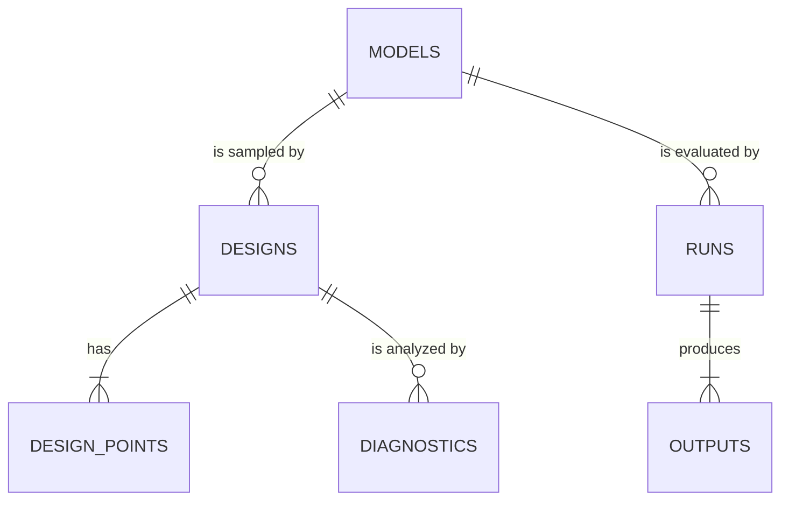

# EMA v2 data model: written specification

> **How to use this template.** Fill it in from top to bottom; the order matters. The questions in §2 come
> before any table, because they decide which tables and columns you need. Lines that start with `>` are
> guidance: delete them once you've filled in a section. Placeholders look like `<…>`. §5.0 is a worked
> example for one table: keep it as a reference or replace it with your own.
>
> **The spec is done when:**
> - every question in §2 is answered by a query in §8;
> - every column in §5 has a logical type from §3.2;
> - every write in §7 names the tables it touches;
> - the checklist in §12 is all ticked.
>
> At that point the `CREATE TABLE` statements (§5), the Python record classes (§10), and the store
> functions (§7, §8) can be written mechanically, one entry at a time. A prompt for Claude Code is at the end.

**Status:** draft | reviewed | accepted  
**Schema version:** 1  
**Author, date:** <name>, <YYYY-MM-DD>  
**Related:** `../notes/v1/ema-redesign.md`, `architecture.md`, decision records `<docs/decisions/NNNN-…>`

---

## 1. Purpose and scope

> Two or three sentences. What does the database remember, and for whom? What is explicitly out of scope?

- **The database records:** <e.g. models and their versions, designs and their points, runs and their
  outputs, diagnostics and their results, and the analyst's approvals>.
- **The one source of truth for:** <list>.
- **Out of scope (not stored, or stored elsewhere):** <e.g. rendered reports and figure images, which are
  regenerated; logs; chat sessions>.
- **Expected scale:** <e.g. up to 10⁶ runs per workspace, 10³ diagnostics, outputs up to 10⁶ values per
  run>. This decides indexes and where arrays live (§6).

---

## 2. Questions the database must answer

> List every question the application, the CLI, the reports, or the agent will ask. Write them in plain
> words, as an analyst or a command would ask them. Give each an id (Q1, Q2, …); §8 answers each with a
> query, and every index in §5 must serve at least one. If a question needs a scan of JSON or re-hashing
> every stored point, a table or column is missing.

| Id | Question | Asked by | How often | Must be fast? |
|---|---|---|---|---|
| Q1 | Which points of this design already have a successful run on this model version? | `run` (before executing) | every diagnostic | yes |
| Q2 | <All diagnostics on output `<qoi>` of model version `<id>`> | <report, CLI `list`> | <…> | <…> |
| Q3 | <Everything behind this figure: result, design, runs, model version, provenance> | <report> | <…> | <…> |
| Q4 | <What did the analyst approve, and when?> | <audit> | <…> | <…> |
| Q5 | <How many new runs has this <campaign / budget> used?> | <budget check> | <…> | <…> |
| Q… | <…> | <…> | <…> | <…> |

---

## 3. Conventions

> Decide these once, so every table follows them. They are what make the code generation mechanical.

### 3.1 Naming

- **Tables:** <plural snake_case nouns: `models`, `runs`>.
- **Columns:** <snake_case; ids are `<entity>_id`; units as a suffix: `wall_time_s`, `peak_mem_mb`>.
- **Booleans:** <named as a statement: `is_isolated`, `experimental`>.

### 3.2 Logical types

> Every column in §5 uses exactly one logical type from this table. Each logical type has one SQL type and
> one Python type, so the column list turns into SQL and code without decisions. Add rows if you need them,
> and remove any you won't use.

| Logical type | SQL (SQLite) | Python | Meaning and format |
|---|---|---|---|
| `id` | TEXT | `str` | <e.g. 12 lowercase hex characters, random; or `name@hash` for model versions> |
| `hash` | TEXT | `str` | <SHA-256, lowercase hex, full 64 characters or truncated to N> |
| `text` | TEXT | `str` | free text |
| `name` | TEXT | `str` | <an identifier a person types: letters, digits, `_`, `-`> |
| `int` | INTEGER | `int` | |
| `real` | REAL | `float` | IEEE double; NaN is not storable in SQLite, so a missing value is NULL |
| `bool` | INTEGER | `bool` | 0 or 1, with `CHECK (col IN (0, 1))` |
| `timestamp` | TEXT | `datetime` | <ISO 8601 in UTC, e.g. `2026-09-28T14:03:07.123Z`> |
| `enum(<Name>)` | TEXT | `<Name>` (an `Enum`) | one of the values listed in §4, with a `CHECK` constraint |
| `json(<Shape>)` | TEXT | `<Shape>` (a dataclass or `dict`) | small metadata only; its shape is defined in §5 under the table; never queried by value |
| `array` | BLOB | `np.ndarray` | `.npy` bytes (`np.save`, `allow_pickle=False`); up to <1 MB> |
| `array_ref` | TEXT | `ArrayRef` | the `hash` of an array in the blob store (§6), for large arrays |

### 3.3 Other rules

- **NULL means:** <"not known yet" or "not applicable": say which, per column, in §5>.
- **Deleting:** <never; or soft delete with a `deleted_at` column; or only a whole workspace>.
- **Immutability:** <which tables are append-only: rows are never updated once written>.
- **Foreign keys:** <enforced with `PRAGMA foreign_keys = ON`: yes or no>.
- **Time:** <all timestamps are written by the store, never by the caller>.

---

## 4. Entities and enumerations

### 4.1 Entities

> One line per kind of thing the database records, in the words of the glossary. Each becomes a table in
> §5 (or several, if it has a list of parts, like a design and its points).

| Entity | One row means | Table(s) | Glossary term |
|---|---|---|---|
| Model version | <one version of one model: its spec and the hash of its files> | `models` | model, model version |
| Design | <…> | `designs`, `design_points` | design |
| Run | <one evaluation of one model version at one input point> | `runs` | run |
| Output | <one QoI of one run> | `outputs` | quantity of interest |
| Diagnostic | <…> | `diagnostics` | diagnostic |
| Approval | <…> | `approvals` | approval |
| <…> | <…> | <…> | <…> |

### 4.2 Relationships

> A Mermaid entity-relationship diagram. `||--o{` reads "one to zero or more". Keep it to the entities
> above; columns go in §5.



### 4.3 Enumerations and state transitions

> Every `enum(...)` column's allowed values, what each means, and which changes are allowed. A status that
> can change needs its transitions listed: any change not listed is a bug the store refuses.

**`RunStatus`** (column `runs.status`)

| Value | Meaning | Reused by the cache? |
|---|---|---|
| `ok` | <the model finished and every output parsed> | yes |
| `failed` | <the model exited with an error, or an output didn't parse> | no |
| `timeout` | <the run exceeded `timeout_s` and was killed> | no |
| `invalid_input` | <the point violates a declared constraint; the model never ran> | <yes: the refusal depends only on the spec> |

Transitions: <none: a run is written once, with its final status.>

**`DiagnosticStatus`** (column `diagnostics.status`)

| Value | Meaning |
|---|---|
| `running` | <…> |
| `complete` | <…> |
| `failed` | <…> |
| `interrupted` | <the process running it died> |

Transitions: `running → complete`, `running → failed`, `running → interrupted`. <Nothing leaves a final
state.>

**`<OtherEnum>`**: <…>

---

## 5. Tables

> One subsection per table, in the same format, so each turns into one `CREATE TABLE` and one record class.
> For each column:
> - **Type** is a logical type from §3.2;
> - **Null** is `no`, or `yes` with what NULL means;
> - **Written by** is the write operation from §7 that sets it;
> - **Mutable** is `no` unless a named operation may change it later.
>
> Under the table, list its keys, its constraints, and its indexes, each index with the questions (Q-ids)
> it serves.

### 5.0 Worked example: `runs`

> This is an illustration of the level of detail wanted, based on v1's `runs` table with outputs moved to
> their own table. Replace it with your own, or delete it.

**Purpose:** one evaluation of one model version at one input point. **Immutable:** yes (append-only).
**Expected rows:** up to 10⁶ per workspace.

| Column | Type | Null | Default | Units | Meaning | Written by | Mutable |
|---|---|---|---|---|---|---|---|
| `run_id` | `id` | no | | | primary key | W3 record_runs | no |
| `model_id` | `id` | no | | | the model version that ran | W3 | no |
| `input_hash` | `hash` | no | | | SHA-256 of the input values written exactly (`float.hex`), sorted by input name | W3 | no |
| `replicate` | `int` | no | 0 | | 0 for ordinary designs; 1, 2, … for deliberate repeats of a point | W3 | no |
| `inputs` | `array` | no | | input units | the input vector, in the order of the model's inputs | W3 | no |
| `status` | `enum(RunStatus)` | no | | | how the run ended | W3 | no |
| `error` | `text` | yes: no error | | | the error message, for a failed run | W3 | no |
| `wall_time_s` | `real` | yes: not measured | | s | the run's elapsed time | W3 | no |
| `peak_mem_mb` | `real` | yes: not measured | | MB | the peak memory of the process that ran it | W3 | no |
| `design_id` | `id` | yes: a test run | | | the design that first asked for this run (for charging it to a budget) | W3 | no |
| `started_at` | `timestamp` | no | | | when the run started | W3 | no |

- **Primary key:** `run_id`.
- **Foreign keys:** `model_id → models.model_id`; `design_id → designs.design_id`.
- **Unique:** `(model_id, input_hash, replicate)` where `status` is reusable: <decide whether a failed run
  may be retried as a second row, or replaced>.
- **Checks:** `replicate >= 0`; `status IN (…)`.
- **Indexes:**
  - `runs_cache ON runs (model_id, input_hash, replicate)` serves Q1;
  - `runs_by_design ON runs (design_id)` serves Q5.

### 5.1 `<table name>`

**Purpose:** <one row means …>. **Immutable:** <yes | no: which columns change, and by which operation>.
**Expected rows:** <…>.

| Column | Type | Null | Default | Units | Meaning | Written by | Mutable |
|---|---|---|---|---|---|---|---|
| `<name>_id` | `id` | no | | | primary key | <W…> | no |
| `<…>` | `<…>` | <…> | <…> | <…> | <…> | <W…> | <…> |

- **Primary key:** <…>.
- **Foreign keys:** <column → table.column>.
- **Unique:** <…>.
- **Checks:** <…>.
- **Indexes:** <index on (columns)> serves <Q…>.
- **JSON shapes:** for each `json(<Shape>)` column, its fields:

  ```text
  <Shape> = {
    <field>: <type>   # meaning, units
    …
  }
  ```

### 5.2 `<table name>`

<Repeat the format of §5.1 for each table.>

---

## 6. Arrays and files outside the database

> Anything too large for a column goes in a content-addressed blob store: each file is named by the
> SHA-256 of its contents, and the database stores only that hash (`array_ref`). Say what goes there, how
> it is laid out, and how it is cleaned up.

- **What is stored outside the database:** <e.g. output fields larger than 1 MB; figure data>.
- **Location:** <e.g. `<workspace>/blobs/<first 2 hex>/<remaining hex>.npy`>.
- **Format:** <`.npy` for one array; `.npz` for several; HDF5 or Zarr for chunked access>.
- **Write order:** the file is written and synced first, then the row referencing it is committed. A crash
  leaves an unreferenced file, never a reference to a missing file.
- **Cleanup:** <e.g. `ema gc` deletes blobs no row references; never automatic>.
- **Integrity check:** <e.g. `ema check` re-hashes every blob and reports mismatches>.

---

## 7. Write operations

> Every way data enters or changes. Each becomes one store function that runs in one transaction. For each,
> list what it needs to be true beforehand (preconditions), which tables it writes, and what it guarantees
> afterwards. If two operations write the same row, say which one wins.

| Id | Operation (store function) | Called by | Preconditions | Writes (table: insert / update) | Atomic unit | Guarantees |
|---|---|---|---|---|---|---|
| W1 | `register_model(spec) -> model_id` | <load model> | <the spec validates> | models: insert if new | one transaction | <registering the same version twice returns the same id and writes nothing> |
| W2 | `record_design(design) -> design_id` | <…> | <…> | designs: insert; design_points: insert | <…> | <…> |
| W3 | `record_runs(batch)` | <execution, after each batch> | <each run's model version exists> | runs: insert; outputs: insert | <one batch> | <a run is recorded only after the model has finished and its outputs are written> |
| W4 | `<…>` | <…> | <…> | <…> | <…> | <…> |

**Batching and durability:** <e.g. runs are committed in batches, at least every N seconds and always on
exit; the rest commit immediately>.

---

## 8. Read operations (answers to §2)

> One row per question from §2: the store function that answers it, and a sketch of its SQL. Every question
> must appear here. If a query needs `json_extract` in a `WHERE` clause, or reads every row of a large table,
> reconsider the tables in §5.

| Q | Store function | Returns | SQL sketch | Index used |
|---|---|---|---|---|
| Q1 | `cached_runs(model_id, input_hashes) -> dict[hash, run_id]` | <the reusable runs, by input hash> | `SELECT input_hash, run_id FROM runs WHERE model_id = ? AND replicate = ? AND status IN ('ok', 'invalid_input') AND input_hash IN (…)` | `runs_cache` |
| Q2 | `<…>` | <…> | <…> | <…> |
| Q… | <…> | <…> | <…> | <…> |

---

## 9. Invariants

> Statements that are always true of a valid database, each with how it is enforced (by the schema, by the
> store's code, or by a test only) and the test that checks it. These become the store's contract tests.

| Id | Invariant | Enforced by | Test |
|---|---|---|---|
| I1 | A run is never updated once written. | store: no update function for `runs` | `test_runs_are_append_only` |
| I2 | Every `array_ref` names an existing blob whose hash matches. | write order (§6) | `test_every_array_ref_resolves` |
| I3 | A diagnostic's status changes only along the transitions in §4.3. | store: `set_status` checks | `test_status_transitions` |
| I4 | Two runs with the same `(model_id, input_hash, replicate)` and a reusable status don't exist. | unique index | `test_cache_key_is_unique` |
| I… | <…> | <…> | <…> |

---

## 10. Mapping to code

> How the schema becomes Python. Fill this in after §5, one row per table. With it, the store module can be
> generated without further decisions.

- **Module:** <`ema/store/` with `schema.sql`, `records.py` (dataclasses), `store.py` (the §7 and §8
  functions), `migrations.py`>.
- **Connection rules:** <e.g. one `Store` object per process; write-ahead logging, with a fallback to the
  rollback journal on a network filesystem; `PRAGMA foreign_keys = ON`>.
- **Concurrency:** <e.g. one writer at a time, many readers; worker processes never write, they send results
  to the parent, which records them>.

| Table | Record class | Created by | Read by |
|---|---|---|---|
| `runs` | `Run` (frozen dataclass) | W3 | Q1, Q3, Q5 |
| `<…>` | `<…>` | <W…> | <Q…> |

---

## 11. Versioning and migrations

> How the schema will change once workspaces exist.

- **Version is stored in:** <a `schema_version` table with one row, or `PRAGMA user_version`>.
- **A migration is:** <a function or SQL script taking version N to N+1, run in one `BEGIN IMMEDIATE`
  transaction that re-reads the version first, so two processes can't both migrate>.
- **Opening an older workspace:** <migrate it automatically / ask first / refuse>.
- **Opening a newer workspace:** <refuse, with a message naming both versions>.
- **Tests:** <a stored schema-1 workspace (`tests/fixtures/workspace_v1.sql`) that each new version must
  open and migrate>.
- **Change log:**

| Version | Date | Change | Decision record |
|---|---|---|---|
| 1 | <YYYY-MM-DD> | first schema | <…> |

---

## 12. Checklist before writing code

- [ ] Every question in §2 has a row in §8, with a query that uses an index or a small table.
- [ ] Every table in §4.1 has a subsection in §5, and every table in §5 appears in §4.1 and the diagram.
- [ ] Every column has a logical type from §3.2, a NULL rule, and the operation that writes it.
- [ ] Every `enum` has its values and transitions in §4.3.
- [ ] Every `json` column has its shape written out, and nothing in it is used in a `WHERE` clause.
- [ ] Every foreign key points to a table that exists, and the diagram shows it.
- [ ] Every write in §7 lists its preconditions and the tables it touches, and no table is written by an
      operation that isn't listed.
- [ ] Every invariant in §9 has an enforcement and a test name.
- [ ] Large arrays have a home (§6), with a write order and a cleanup rule.
- [ ] The migration policy (§11) is decided.
- [ ] Every entity uses the glossary's term.

---

## Appendix: a prompt for Claude Code

> Once the checklist is ticked, something like this turns the spec into code in reviewable steps.

```text
Read docs/<path>/data_model_spec.md. It is the accepted spec for EMA's data model.
Step 1: write ema/store/schema.sql from §3 and §5 (one CREATE TABLE per table, with every key, check,
and index listed there, and nothing that isn't). Stop and show me the SQL.
Step 2: write ema/store/records.py: one frozen dataclass per table (§10), using the Python types from §3.2.
Step 3: write ema/store/store.py: one function per write operation (§7) and per read operation (§8), each
with a docstring citing its W- or Q-id. No other public functions.
Step 4: write tests/test_store_contract.py: one test per invariant in §9 (named as in the spec), plus a
round-trip test per table and one test per question in §2.
If the spec is ambiguous or incomplete anywhere, stop and ask; don't decide for me.
```
