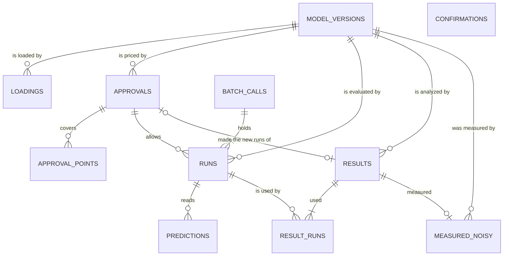

# Data model

**Status:** accepted. **Updated:** 2026-10-01, from an interview (TODO step 8); Q13–Q15, W5 on a stored id, and connections by
0056; the confirmation's path and Q4's first approval by 0057; doubles, the run id's bytes, Q7's tails, and replay's
point check by 0061; replays from stored points, Q15's points, and the hashed objects' shapes by 0062; the design's structure in the
provenance by 0063; 2026-10-02: the request's canonical keys, the column forms, and timestamps by 0070; the writes' signatures,
W5's checks, a result's measured-noisy `made_at`, `current_keys`, Q8's to Q13's returns, and the untyped `value` by 0072;
`model_names` and rebuilding an incomplete result directory by 0080; review round 1 of applying 0066–0085;
2026-10-03: the hashed spec's `files` and `pass_env` sorted (0086 item 4); a workspace from before 2.0.0.dev1 rebuilt (0087 item 3).
**Schema version:** 1.
**Depends on:** P1, P3–P7; `model_interface.md`, `designs.md`, `diagnostics/shared.md`, `point_run.md`,
`uncertainty.md`, `contracts.md` (C17, C46–C52, C56), `export.md`; records 0006, 0010, 0011, 0015, 0020–0022,
0025, 0028–0030, 0032, 0041, 0043, 0044, 0046, 0049, 0050, 0054, 0055, 0056, 0086, and 0087.

> What the store keeps, how it is keyed, and what it answers, so that `ema/store/` can be written one table
> and one function at a time. The interview settled four behaviors a user sees (0054); everything else here is
> a storage choice made to fit the other specs, and is checked against them in §12. 0055 fixes
> what the independent review found.

## 1. Purpose and scope

- **The database records:** model versions and their loadings (location and settings), confirmations,
  approvals and the points they cover, runs and their model predictions, batch calls, diagnostic results with their provenance and the
  runs they used, and measured-noisy records.
- **The one source of truth for:** every number a user sees (P1), what was approved (P3), and where a
  diagnostic result came from (P5).
- **Out of scope:** the model's own directory (EMA keeps the spec and the files' hashes, and copies only shared
  files, 0030); logs; `.env`; MCP chat; campaigns and budgets (0006, 0050); runs still in progress (a later
  asynchronous executor keeps them in a table of their own, 0015).
- **Scale:** fast to 10⁶ stored runs, working to the design cap of 10⁷ points (§6). Typical workspaces hold
  10²–10⁵ runs and 10¹–10³ diagnostic results.

### Workspace layout

```text
<workspace>/
  ema.db                    the database: SQLite, from Python's standard library
  run.lock                  held while a process makes runs (§10)
  runs/<run id>/            run directories, kept by `keep` (0020, 0028); batch directories beside them (0025)
  files/<sha256>/<name>     shared model files, read-only (0030)
  results/<result id>/      report.md, its PNGs, and their data cards, written once (§6)
```

## 2. Questions the store answers

| Id | Question | Asked by | Must be fast? |
|---|---|---|---|
| Q1 | For each point and replicate of this design, which run is current there, if any, and did it fail? | pricing and running (C46–C48) | yes: 10⁶ points in under 10 s |
| Q2 | How many runs are stored for this model version, and what is their mean run time? | the price: "about 1 h 52 min (from 41 stored runs)" (P3, U2) | yes |
| Q3 | Which model version, spec file, and settings does this model name mean now? | every workspace call that names a model; loading's message ("was heat@b204 at …") (0029, 0054) | yes |
| Q4 | Has this model version had an approval answered yes? | the first approval shows the command (or a Python function's `function`), templates, files, and the environment the spec sets (U2, `trust.md`) | yes |
| Q5 | Is a diagnostic result stored for this reuse key? | a repeated request (C50, 0054) | yes |
| Q6 | A diagnostic result: its numbers, request, design, provenance, and approval | `get_result`, `report`, `reproduce`, export, MCP | yes |
| Q7 | A diagnostic result's runs, in design order, with their points, status, kind, reason, stderr tail, model predictions, time, host, program, and approval (the tail, 0061) | export (E2), `failed_runs` (U3) | yes: 10⁶ rows in seconds |
| Q8 | Which diagnostic results exist, by model name, model version, diagnostic, or model prediction, newest first? | `list_results` (U6), MCP | no |
| Q9 | A run, by its id, or the runs of a diagnostic result at a point (one per replicate): each one's record, run directory, and batch call | the run-directory lookup (0020) | no |
| Q10 | Which point runs measured this model version noisy in this model prediction, newest first? | notes on later diagnostic results (PT4, C52) | yes |
| Q11 | Which id does this prefix name, and what is an id's shortest unique prefix? | every id typed or shown | yes |
| Q12 | Every approval and confirmation, with its question and answer, in order | audit (T3) | no |
| Q13 | Which of these keys does this approval cover and not yet have a run for, and for which model version? | the runner, before each call (P3, 0056) | yes |
| Q14 | A model version's spec and tracked files, by its id | `report`, export, `reproduce` (U6, 0056) | yes |
| Q15 | These runs, by id, in this order (a repeated id repeated) | every run batch (C56), `reproduce` (U8, 0056) | yes: 10⁶ rows in seconds |

## 3. Conventions

### 3.1 Naming

- **Tables:** plural snake_case nouns in the glossary's words: `model_versions`, `runs`, `predictions`
  (model predictions), `results` (diagnostic results).
- **Columns:** snake_case; ids are `<entity>_id`; units as a suffix (`time_s`, `timeout_s`); booleans as
  statements (`answer` is the one boolean, "yes").

### 3.2 Logical types

| Logical type | SQL (SQLite) | Python | Meaning and format |
|---|---|---|---|
| `id` | BLOB (32 bytes) | `str` (64 hex) | the SHA-256 of what identifies the row; how it is shown is in §3.4 |
| `hash` | BLOB (32 bytes) | `str` (64 hex) | a SHA-256 that is not an id (a point's, a file's) |
| `text` | TEXT | `str` | free text |
| `name` | TEXT | `str` | a model, model parameter, model prediction, or diagnostic name (`model_interface.md`, Names) |
| `path` | TEXT | `Path` | an absolute path, resolved when written |
| `int` | INTEGER | `int` | |
| `real` | REAL | `float` | a finite double; a missing value is NULL, never NaN |
| `bool` | INTEGER | `bool` | 0 or 1, with a `CHECK` |
| `timestamp` | TEXT | `datetime` | ISO 8601 in UTC, to the millisecond: `2026-10-01T14:03:07.123Z`; one rule for every stored timestamp (`ema.types.text.timestamp_text`, `parse_timestamp`): a naive datetime is refused, and a timestamp a type holds is converted to UTC and cut to the millisecond, so it reads back equal (0070) |
| `enum(<Name>)` | TEXT | `<Name>` (an `Enum`) | one of the values in §4.3, with a `CHECK` |
| `json(<Shape>)` | TEXT | `<Shape>` | canonical strict JSON (§3.4); its shape is in §5; never in a `WHERE` clause |

### 3.3 Rules

- **Immutable:** no row is ever updated. The only deletion is `delete_result` (W6), which removes a diagnostic
  result and its rows; runs, model versions, approvals, and the rest are kept for the workspace's lifetime.
  A loading that changes a model name's directory or settings is a new row, not an update (Q3).
- **NULL means** "not applicable", and each nullable column says when (§5).
- **Foreign keys** are enforced (`PRAGMA foreign_keys = ON`).
- **Time:** every timestamp is written by the store. No timestamp is part of an id, a key, or a report.
- **Durability:** each write (§7) is one transaction, committed before it returns: a run, or a batch call's
  runs, as soon as the call is collected. Measured: 1.0 ms per run (rollback journal, `synchronous=FULL`,
  2026-10-01).

### 3.4 Canonical encodings, hashes, and ids

- **Canonical JSON:** `json.dumps(x, sort_keys=True, separators=(",", ":"), ensure_ascii=False,
  allow_nan=False)`. A double is written by Python's `repr`, the shortest decimal that reads back exactly, so
  every double round-trips, −0.0 and subnormals included (C17, verified in the review). Integers stay
  integers. NaN and infinity can't be written: a missing value is `null`, with its reason beside it.
- **Doubles for model parameter values** (0061): every value in model parameter units (nominal values,
  limits, range ends, held values, a point's `x`, anchors) and every given direction (in unit coordinates) becomes a double when parsed,
  from a model spec, a space, or a diagnostic parameter, before anything is hashed. So `45` and `45.0`, or a
  space from `--space FILE` and the same space in Python, give one model version and one reuse key. Integer
  diagnostic parameters (`n`, `repeats`, the seed) stay integers; alpha keeps its decimal string (0047).
- **A point** is its doubles in the model spec's order of model parameters, held ones included (0023).
  - **Point hash:** the SHA-256 of those doubles as little-endian IEEE float64 bytes, 8·d bytes. Exact bits:
    −0.0 and 0.0 are different points, as any two doubles that differ are (P3); a model may treat them
    differently (1/x).
  - **Stored** as a JSON list of doubles, in the same order.
  - **Across machines:** a log range's points, and random lines' points, can differ in their last bits
    between machines (`designs.md`, Determinism; 0062). Such a point is a different point, so a design rebuilt there makes new runs,
    which its price shows; correctness is unaffected. This answers 0044's question: runs are matched by exact
    point only, as P3 says (0051).
- **A model version's hash** (its id): the SHA-256 of the canonical JSON of `{"spec": …, "files": […]}`.
  - **The spec** is parsed and written again with every field, each default filled in (`"noisy": false`,
    `env` `{}`, a parser's `match` `"last"`), each `files` entry as `{"path": …, "shared": …}`, and each path
    relative, with `/`. So a default written out or left out is the same model version (M3). It is without
    its location, `keep`, `batch_size`, and `timeout_s` (0029). Its `files` are sorted by path and its
    `pass_env` by name, in the hash only, so a list in another order is the same model version too; the spec
    stored in `model_versions` keeps the order of the loading that stored it (0086 item 4).
  - **The files** are the tracked files (the function's file, the input deck templates, the listed files),
    each as `[relative path, sha256 of its contents, shared]`, sorted by path.
  - **Shown** always as `name@` and its first 12 hex digits (`model_interface.md`).
- **A request**, canonical: the diagnostic, the model prediction, the model parameter space in
  `designs.md`'s JSON form with every range written `{"range": [lo, hi], "scale": …}`, and every diagnostic
  parameter, with each default filled in (the seed 0, the only model prediction, `repeats` 4). A float alpha
  keeps its decimal string (0047). `approve` and `retry_failed` are not part of it. It is the object
  `{"diagnostic", "prediction", "space", "params"}`, the space null for the point run (0070). The test run's
  request is `{"test_run": {"point": […]}}`.
- **A design's identity** (0046, 0032): the request's design part (kind, space, generator parameters, seed,
  sampler and its version, generator version) and the model version. Stored with each diagnostic result and
  approval; with the provenance's design structure and the stored runs' points, a replay needs no generator,
  and with today's generator at the identity's versions the design can also be rebuilt (0063).
- **Ids:** every id is the SHA-256 of what identifies its row, so the same work in two fresh workspaces gets
  the same ids. Then a report holding ids, such as U9's, is byte-identical to U1's.

  | Row | Its id is the SHA-256 of |
  |---|---|
  | model version | its canonical JSON (above) |
  | run | the model version id and the point hash as hex text (UTF-8), then the replicate and the attempt (8-byte little-endian integers) (0061) |
  | batch call | its runs' ids, in call order |
  | approval | the canonical JSON of the object `{"model_version_id", "asked_for", "request", "new", "reused", "n_before"}`: the model version id, what it is for (`asked_for`), the request, the counts of new and reused runs, and the number of approvals stored before it in the workspace (0062) |
  | diagnostic result | its reuse key (below) |

  Loadings and confirmations have no id: nothing names them.
- **Shown** (0055):
  - **in a report:** a diagnostic result's or an approval's id as its first 12 hex digits, so a report rebuilt
    later is byte-identical (P1, S10). There are at most about 10⁴ of each, and 12 digits collide with
    probability about 10⁻⁷;
  - **in data cards and exports:** in full, since 12 digits of 10⁷ run ids would collide with probability
    about 0.2;
  - **in the CLI, the MCP server, and Python's printed summaries:** by the shortest prefix of at least 4 hex
    digits that is unique among ids of its kind, as git shows commits. A typed prefix of at least 4 digits
    that names one id is accepted; one that names several is refused, listing them.
- **The reuse key** of a diagnostic result (C50, 0054): the canonical JSON of the object
  `{"model_version_id", "request", "run_ids", "versions"}`: the model version id, the canonical request, the
  ids of the runs the design resolves to, in design order, and the versions of EMA, numpy, scipy, and
  matplotlib, an object with the keys `ema`, `numpy`, `scipy`, and `matplotlib` (0062). Changing any of these makes a new diagnostic result. The design's identity
  needs no place of its own: the request and EMA's version decide it. The measured-noisy records read are not
  part of the key: a repeated request made before a point run returns the stored result, without the note
  (`point_run.md`).
- **Data cards** (`diagnostics/shared.md`) are written with the same encoder, indented 2 spaces, with a final
  newline, so a rebuilt data card is byte-identical (S10).

## 4. Entities and enumerations

### 4.1 Entities

| Entity | One row means | Table | Glossary term |
|---|---|---|---|
| Model version | one model spec and the contents of its tracked files | `model_versions` | model version |
| Loading | one `load_model` of a spec file: the name now means this model version, at this path, with these settings | `loadings` | |
| Confirmation | the user's answer to saving a model spec an MCP client drafted | `confirmations` | confirmation |
| Approval | the user's answer to one price, for a diagnostic evaluation's new runs or the test run | `approvals` | approval, price |
| Approved point | one point and replicate an approval covers (P3) | `approval_points` | |
| Run | one evaluation of a model version at one point, as one replicate and one attempt | `runs` | run, failed run, test run |
| Batch call | one call of a batch Python function, over several runs | `batch_calls` | call |
| Model prediction | one model prediction of one ok run: its value, or its reason | `predictions` | model prediction |
| Diagnostic result | what one diagnostic evaluation produced, with its provenance | `results` | diagnostic result, provenance |
| Run used | one design row of a diagnostic result, and the run it used | `result_runs` | |
| Measured noisy | one point run that measured a model version noisy in one model prediction | `measured_noisy` | noisy |

No `designs` table: a design is built from its identity, stored with each diagnostic result and approval (a
replay's from the stored points and the provenance's design structure, 0063),
and its rows are tied to runs by `result_runs`. Shared model files need no table: they are named by their
hash (§6).

### 4.2 Relationships



`confirmations` stands alone: a confirmation saves a spec file, which a later loading may read.

### 4.3 Enumerations

No row changes once written (§3.3), so no enumeration has transitions.

**`RunStatus`** (`runs.status`; `model_interface.md`, Failures)

| Value | Meaning |
|---|---|
| `ok` | the call finished cleanly and read at least one model prediction (0043) |
| `failed` | the call failed, with a kind; reused like any stored run unless retry is asked (0010) |

**`FailureKind`** (`runs.kind`): `error`, `timeout`, `unread` (`model_interface.md`).

**`ApprovalFor`** (`approvals.asked_for`): `diagnostic_evaluation`, `test_run` (0049).

**`Keep`** (`loadings.keep`): `all`, `incomplete`, `none` (0028).

## 5. Tables

Every table is append-only (§3.3); "Written by" names the write in §7.

### 5.1 `model_versions`

**One row:** one model version. **Rows:** tens per model.

| Column | Type | Null | Meaning | Written by |
|---|---|---|---|---|
| `model_version_id` | `id` | no | the version hash (§3.4) | W1 |
| `name` | `name` | no | the model's name | W1 |
| `spec` | `json(ModelSpec)` | no | the model spec, canonical, without its location and settings (§3.4, 0029) | W1 |
| `files` | `json(list[TrackedFile])` | no | each tracked file: `[relative path, sha256, shared]`, sorted by path | W1 |
| `created_at` | `timestamp` | no | when it was first loaded | W1 |

- **Primary key:** `model_version_id`. **Index:** `(name)` serves Q8's filter by model name.

### 5.2 `loadings`

**One row:** one `load_model`. The latest loading of a name says what the name means now: its model version,
spec file, and settings (0029, 0054). **Rows:** one per loading.

| Column | Type | Null | Meaning | Written by |
|---|---|---|---|---|
| `loading` | `int` | no | SQLite's row id, increasing | W1 |
| `name` | `name` | no | the model's name | W1 |
| `model_version_id` | `id` | no | the model version loaded | W1 |
| `spec_path` | `path` | no | the spec file loaded; its directory is the model's directory | W1 |
| `keep` | `enum(Keep)` | no | `keep` (0020, 0028) | W1 |
| `batch_size` | `int` | yes: all new runs in one call (0025) | `batch_size` | W1 |
| `timeout_s` | `real` | no | `timeout_s` (default 3600) | W1 |
| `loaded_at` | `timestamp` | no | when | W1 |

- **Primary key:** `loading`. **Foreign key:** `model_version_id`. **Index:** `(name, loading)` serves Q3.

### 5.3 `confirmations`

**One row:** one question to save a model spec an MCP client drafted, and its answer (0016, 0049, T3).

| Column | Type | Null | Meaning | Written by |
|---|---|---|---|---|
| `confirmation` | `int` | no | SQLite's row id | W2 |
| `spec_path` | `path` | no | where the spec would be, or was, saved: the absolute path shown (`trust.md`, T6) | W2 |
| `spec_sha256` | `hash` | no | the hash of the file's bytes as shown | W2 |
| `question` | `text` | no | the text shown, in full | W2 |
| `answer` | `bool` | no | yes or no | W2 |
| `asked_at` | `timestamp` | no | when | W2 |

### 5.4 `approvals`

**One row:** one price shown and its answer (P3, 0049, T3). Declined approvals are stored; no run
references them. An approval is used once: by the diagnostic evaluation, or the test run, that asked for it
(W5 refuses a result whose approval was asked for another request, or is cited by another stored result, 0072).

| Column | Type | Null | Meaning | Written by |
|---|---|---|---|---|
| `approval_id` | `id` | no | §3.4 | W3 |
| `model_version_id` | `id` | no | the model version priced | W3 |
| `asked_for` | `enum(ApprovalFor)` | no | a diagnostic evaluation's new runs, or the test run | W3 |
| `request` | `json(Request)` | no | the canonical request, or the test run's (§3.4) | W3 |
| `design` | `json(DesignIdentity)` | yes: the test run | the design's identity (§3.4) | W3 |
| `new` | `int` | no | new runs priced: the number of its approved points | W3 |
| `reused` | `int` | no | reused runs | W3 |
| `reused_failed` | `int` | no | of the reused, how many failed (C47) | W3 |
| `time_s` | `real` | yes: "unknown" | the time estimated: `new` × Q2's mean | W3 |
| `question` | `text` | no | the text shown, in full | W3 |
| `answer` | `bool` | no | yes or no | W3 |
| `asked_at` | `timestamp` | no | when | W3 |

- **Primary key:** `approval_id`. **Check:** `new ≥ 1` (no approval is asked for no new runs, C50).
- **Index:** `(model_version_id, answer)` serves Q4.

### 5.5 `approval_points`

**One row:** one point and replicate an approval answered yes covers: P3's "an approval records the model
version hash and the new points it covers". A run may be made only at an approved point of its approval, and
only once (I4). **Rows:** the sum of the approvals' new runs.

| Column | Type | Null | Meaning | Written by |
|---|---|---|---|---|
| `approval_id` | `id` | no | | W3 |
| `point_hash` | `hash` | no | | W3 |
| `replicate` | `int` | no | | W3 |

- **Primary key:** `(approval_id, point_hash, replicate)`, a table without row ids; serves W4's check.
- **Foreign key:** `approval_id`. Written only for an answer of yes.

### 5.6 `runs`

**One row:** one finished call's run (C49). **Rows:** up to 10⁷.

| Column | Type | Null | Meaning | Written by |
|---|---|---|---|---|
| `run_id` | `id` | no | §3.4 | W4 |
| `model_version_id` | `id` | no | the model version that ran | W4 |
| `point_hash` | `hash` | no | §3.4 | W4 |
| `replicate` | `int` | no | 0, or the point run's repeats 1, 2, … (0011) | W4 |
| `attempt` | `int` | no | 0 for the first run at this key; 1, 2, … for each retry (0010) | W4 |
| `point` | `json(list[real])` | no | the point, in the model spec's order | W4 |
| `status` | `enum(RunStatus)` | no | | W4 |
| `kind` | `enum(FailureKind)` | yes: ok | | W4 |
| `reason` | `text` | yes: ok | the one-line reason (`exited with code 2`); notes group by it (`shared.md`) | W4 |
| `stderr_tail` | `text` | yes: ok, or nothing written | the last 15 lines of stderr, or of the traceback | W4 |
| `exit_code` | `int` | yes: a Python function, a program that couldn't start, or a timeout | the program's exit code; −N for signal N | W4 |
| `time_s` | `real` | no | the call's time, or a batch call's share (0025) | W4 |
| `batch_call_id` | `id` | yes: not batched | its batch call (0025) | W4 |
| `host` | `text` | no | where it ran (0015) | W4 |
| `program` | `path` | no | the program's resolved path; for a Python function, the child's interpreter (0029) | W4 |
| `approval_id` | `id` | no | the approval it was made under (C48) | W4 |

- **Primary key:** `run_id`. **Foreign keys:** `model_version_id`, `batch_call_id`, `approval_id`.
- **Unique:** `(model_version_id, point_hash, replicate, attempt)`; serves Q1.
- **Index:** `(model_version_id, time_s)` serves Q2 from the index alone: 0.09 s over 10⁶ runs, against 3.2 s
  reading the table (measured 2026-10-01).
- **Checks:** `replicate ≥ 0`; `attempt ≥ 0`; `kind` and `reason` null exactly when `status = 'ok'`.
- **The current run at a key** is the one with the highest attempt. A retry is stored beside the failed run
  it replaces, as the next attempt (C47); earlier diagnostic results keep the run they used (`result_runs`),
  and later designs use the retry (0010).
- **The run directory** is `runs/<run id>/`, kept or not by `keep`. Whether it is kept is read from the
  filesystem, so a directory deleted by hand reads as not kept (0020; `ema_run_dir`, E2).

### 5.7 `batch_calls`

**One row:** one batch call (0025). Its directory, `runs/<batch call id>/`, is kept while any of its runs'
directories is kept, and deleted with the last of them.

| Column | Type | Null | Meaning | Written by |
|---|---|---|---|---|
| `batch_call_id` | `id` | no | §3.4 | W4 |
| `size` | `int` | no | its runs (0025) | W4 |
| `time_s` | `real` | no | its whole time | W4 |

### 5.8 `predictions`

**One row:** one model prediction of one ok run (0021, 0022). A failed run has none: all of its model
predictions are missing, for its run's reason. **Rows:** runs × model predictions.

| Column | Type | Null | Meaning | Written by |
|---|---|---|---|---|
| `run_id` | `id` | no | | W4 |
| `name` | `name` | no | the model prediction | W4 |
| `value` | `real`, with no declared type | yes: missing | the value read | W4 |
| `reason` | `text` | yes: read | why it is missing (`plate.out: pattern not found`) | W4 |

- **Primary key:** `(run_id, name)`, a table without row ids. **Foreign key:** `run_id`.
- **Check:** exactly one of `value` and `reason` is null. An ok run has one row per model prediction in its
  spec (I6).
- **`value` has no declared type,** with `CHECK (typeof(value) IN ('real', 'null'))`: a `REAL` column stores an
  integral double as an integer and reads −0.0 back as 0.0 (measured with SQLite 3.53), which would break C17's
  "every double exact" (0072). The other `REAL` columns hold times, a standard deviation, and a timeout, all ≥ 0.

### 5.9 `results`

**One row:** one diagnostic result and its provenance (P5). **Rows:** 10¹–10⁴.

| Column | Type | Null | Meaning | Written by |
|---|---|---|---|---|
| `result_id` | `id` | no | the hash of its reuse key (§3.4) | W5 |
| `model_version_id` | `id` | no | | W5 |
| `diagnostic` | `name` | no | | W5 |
| `prediction` | `name` | no | the model prediction analyzed | W5 |
| `request` | `json(Request)` | no | canonical (§3.4) | W5 |
| `design` | `json(DesignIdentity)` | no | the design's identity; with the provenance's design structure and the stored runs' points, export and `reproduce` don't depend on today's code (0063) | W5 |
| `approval_id` | `id` | yes: no new runs | the approval of its own new runs (0054) | W5 |
| `result` | `json(DiagnosticResult)` | no | estimates (a "none" interval is null, with its reason, 0041), observations, counts, notes, and figures' names; the polynomial model's coefficients and multi-indices with their intervals (0041): exactly the keys `title`, `counts`, `header_rows`, `notes`, `estimates`, `observations`, `figures`, and `extra` (`DiagnosticResult.column()`, 0070) | W5 |
| `provenance` | `json(Provenance)` | no | EMA's and the libraries' versions, the spawn tags (0041), each measured-noisy record read, in full, and the design's structure (a convergent design's level sizes; each line's anchor, direction, ends, and rows; 0063): exactly the keys `ema`, `numpy`, `scipy`, `matplotlib`, `spawn_tags`, `measured_noisy_read`, and `design_structure` (`Provenance.column()`, 0070) | W5 |
| `made_at` | `timestamp` | no | when | W5 |

- **Primary key:** `result_id`; so one result per reuse key (C50). **Index:** `(model_version_id, made_at)`
  serves Q8.
- **The two JSON columns hold only what has no column or table of its own** (0070): the ids, the diagnostic,
  the model prediction, the request, the design, and the approval are columns; the run ids are `result_runs`'
  rows; the result's own measured-noisy record is `measured_noisy`'s row. Writing the whole result's JSON would
  copy `result_runs` again: a 10⁷-row design's run ids are about 670 MB of hex text. The whole JSON
  (`to_json`) is an export's `result.json` (`export.md`) and C17's form.
- **Provenance,** as P5 lists it: EMA's and the libraries' versions and the spawn tags (`provenance`), the
  model version, the request, the runs used (`result_runs`), and the approvals (its own in `approval_id`; each
  run's in `runs.approval_id`, C51). The `Provenance` a caller gets from Q6 holds all of these, the run ids in
  design order included, so a replay works from it after the result is deleted (§9, 0055).
- **New runs** of a result are the runs whose approval is its approval (E6's `ema_new`). The header's new and
  reused counts are those of the diagnostic evaluation that made it (`shared.md`).

### 5.10 `result_runs`

**One row:** one design row of a diagnostic result (C56). Rows at the same point share a run (`designs.md`,
Rows and runs). **Rows:** the sum of the results' design rows.

| Column | Type | Null | Meaning | Written by |
|---|---|---|---|---|
| `result_id` | `id` | no | | W5 |
| `row` | `int` | no | the design row, from 0 (`ema_row`) | W5 |
| `run_id` | `id` | no | the run it used | W5 |

- **Primary key:** `(result_id, row)`, a table without row ids; serves Q7 and Q9.
- **Foreign keys:** `result_id`, `run_id`.

### 5.11 `measured_noisy`

**One row:** one point run that measured a model version noisy in one model prediction (P7, PT4, C52). A later
result copies each row it reads into its provenance, so its notes can be replayed even after the point run's
result is deleted.

| Column | Type | Null | Meaning | Written by |
|---|---|---|---|---|
| `result_id` | `id` | no | the point run's diagnostic result | W5 |
| `model_version_id` | `id` | no | | W5 |
| `prediction` | `name` | no | | W5 |
| `point` | `json(list[real])` | no | x | W5 |
| `runs` | `int` | no | the runs at the point | W5 |
| `std` | `real` | yes: one usable run (the failures vary) | the standard deviation, ddof 1 | W5 |
| `made_at` | `timestamp` | no | when: the point run's result's `made_at`, set by W5 | W5 |

- **Primary key:** `result_id`. **Foreign keys:** `result_id`, `model_version_id`.
- **Index:** `(model_version_id, prediction, made_at)` serves Q10.
- **Only the point run's own** (I10, 0072): W5 writes a row only with a point run's result (`diagnostic` is
  `point_run`), and only that result's record: its result id, model version, and model prediction.
- **`made_at` is the store's** (0072): a diagnostic can't know the time, and a result is a function of its
  request and runs (P4), so the record a `DiagnosticResult` holds has `made_at` None. W5 refuses one that is
  set, and writes the result's own `made_at` (one transaction time); Q10 reads the row with its `made_at`
  (a later result's provenance copies it so); Q6 returns the result's own record with `made_at` None, so a
  result stored and read back, or replayed, equals itself.

### 5.12 JSON shapes

`ModelSpec` is `model_interface.md`'s spec; `Request` and `DesignIdentity` are §3.4's; `DiagnosticResult`
is `architecture.md`'s (step 9), stored as C17 says; `Provenance` holds `ema`, `numpy`, `scipy`, and
`matplotlib` (version strings), `spawn_tags` (a list of integers), `measured_noisy_read` (each row read,
with all its columns, newest first), and `design_structure` (0063, 0070). Step 9 names the dataclasses; a field added later is a schema change
(§11).

## 6. Files outside the database, and scale

- **Run directories** (`runs/<run id>/`, 0020): written by prepare. A directory with no row is a call that
  never finished (C49); prepare clears one at a path it needs, since a rerun's run has the same id. After
  collect, the run's row is committed (W4), and then the directory is deleted if `keep` says so. A run
  directory is never changed after its run.
- **Shared files** (`files/<sha256>/<name>`, 0030): written read-only once, before the first run that links
  them; a model version's `files` names them.
- **Result directories** (`results/<result id>/`): the report, its PNGs, and their data cards, written to a
  temporary directory (`results/.<first 12 hex digits>-<random>`, on the same file system, so the rename is
  atomic) and renamed into place before W5 commits (`result_directory(result_id, *, complete=None)`). A
  directory with no row is ignored and replaced; one already in place with a row (two identical requests at
  once) is kept, and the new temporary directory discarded (0056). A directory in place is never deleted where
  it is: one to replace is moved aside under the write lock, which W5 also holds while it looks for the
  directory, and deleted after the commit, so several processes at once all succeed (0072; W6 likewise). A
  missing or incomplete directory (its report, a PNG, or a data card missing) is rebuilt from the store by
  `report`, `export`, and `reproduce`: given `complete`, `result_directory` replaces an incomplete directory in
  place as a leftover is, and keeps a complete one, never moving it from under its reader (0080). The report
  and the data cards are byte-identical (P1's test, S10), the PNGs need not be. Export copies it as `report/`
  (E1).
- **Cleanup:** none automatic. Deleting a run directory by hand loses nothing EMA needs (0020).
- **Scale, measured 2026-10-01** (SQLite, 20 model parameters, half the points stored):

  | Stored runs | Q1 on 10⁴ points | 10⁵ | 10⁶ | Hash 10⁶ points | Size of the run key |
  |---|---|---|---|---|---|
  | 10⁶ | 0.04 s | 0.27 s | 2.6 s | 1.2 s | 95 MB |
  | 10⁷ | 0.15 s | 0.42 s | 4.3 s | | 960 MB |

  Q1 looks up points in chunks of 30,000 (one query per point is 3× slower). A full run row with its
  predictions, approved point, and run used is about 5× the key, so the cap's workspace is several GB. A
  slow-tier test prices a 10⁶-point design against 10⁶ stored runs in under 10 s.

## 7. Writes

Each is one store function and one transaction.

| Id | Store function | Called by | Preconditions | Writes | Guarantees |
|---|---|---|---|---|---|
| W1 | `record_loading(spec, spec_path, files) -> model_version_id` | `load_model` | the spec validates (`model_interface.md`); `spec_path` is absolute (`ValueError` otherwise), and is stored resolved (`os.path.realpath`) | `model_versions` if new (its `spec` is `versioned_json()`, so Q14's spec has the default settings; the loading's are Q3's); `loadings` | a repeated loading adds a loading row only; the name now means this version, path, and settings (0054) |
| W2 | `record_confirmation(spec_path, spec_sha256, question, answer)` | `save_model` (MCP) | | `confirmations` | |
| W3 | `record_approval(*, model_version_id, asked_for, request, design, price, question, answer, points) -> approval_id` | the approval module, after the answer | the price was computed from Q1 and Q2; `points` are the new keys priced (`RunKey`s), exactly `price.new` distinct points and replicates; a design is given exactly when it isn't the test run; no new runs, points that aren't the price's, or a repeated key are refused (`ValueError`), an unknown model version is `NotFound` (0072) | `approvals`; `approval_points` when the answer is yes | every answer is stored, yes or no (T3); the approvals before it, for its id, are counted in the same transaction |
| W4 | `record_call(runs, batch_call=None)` | the runner, after each call's collect | each run's directory is written (the runner's part of I5; W4 doesn't look); each run's key is an approved point of its approval, which said yes for its model version, and no stored run of that approval has that key; each run's attempt is one more than the key's current run, which failed, or 0 when there is none. With no batch call, one run; a batch call (`records.BatchCall`) has the id `batch_call_id` of its runs in call order, its size their number, and each run names it. A failed precondition (I2, I3, I4, I6) is `ValueError`, and nothing is stored (0072) | `runs`; `predictions`; `batch_calls` for a batch call | the call's runs are stored together or not at all (C49) |
| W5 | `record_result(result) -> DiagnosticResult` | the workspace, after the analysis | the result carries what W5 writes: its provenance (the `provenance` column, the request, the design, the approval), its run ids, and a point run's measured-noisy record (0072). Checked in the transaction, before writing: the result id is the SHA-256 of its reuse key, recomputed from its provenance; the result directory is in place; every run exists (`NotFound`) and is of the result's model version; its approval, when it has one, said yes to a diagnostic evaluation of that model version, was asked for its request (the canonical requests equal), and is cited by no other stored result; its counted new runs, its distinct runs made under its approval, all of the approval's runs, and the approval's `new` are one number (I12: an evaluation interrupted before every priced run was made stores no result, C49, and its rerun asks, and cites, an approval of its own, 0054); a measured-noisy record only on the point run's result, its own, with `made_at` None (I10). A failed check is `ValueError`, and nothing is written | `results`; `result_runs`; `measured_noisy` when the point run measured noise, with the result's `made_at` | the result, its provenance, and its runs are written together (C51); on a result id already stored (two identical requests at once), it writes nothing and returns the stored result (I7, 0056) |
| W6 | `delete_result(result_id)` | tests (C51, U8); no public name in v2.0 (0056) | | deletes its `measured_noisy`, `result_runs`, and `results` rows, then its directory | runs and approvals are kept |

A repeated request (C50, 0054) writes nothing: it resolves the design (Q1), computes the reuse key, finds the
result (Q5), and returns it, with no approval asked.

## 8. Reads

| Q | Store function | Returns | SQL sketch | Index |
|---|---|---|---|---|
| Q1 | `current_runs(model_version_id, point_hashes) -> dict[(hash, replicate), Run]`; `current_keys(model_version_id, point_hashes) -> dict[(hash, replicate), CurrentKey]` | the current run at each stored key; or only its `CurrentKey(run_id, attempt, status)`, what `resolve` and `price` need: about 0.7 s per 10⁵ stored runs against `current_runs`' 2.4 s (0072) | per chunk of 30,000: `SELECT … FROM runs WHERE model_version_id = ? AND point_hash IN (…)`; the highest attempt per key kept | the unique key |
| Q2 | `run_times(model_version_id) -> (int, float \| None)` | the number of stored runs, any status, and their mean `time_s`; None when there is none | `SELECT COUNT(*), AVG(time_s) FROM runs WHERE model_version_id = ?` | `(model_version_id, time_s)` |
| Q3 | `current_loading(name) -> Loading \| None`; `model_names() -> tuple[str, ...]` | the latest loading of a name; every model name loaded, sorted, for `list_models` (0080) | `… FROM loadings WHERE name = ? ORDER BY loading DESC LIMIT 1`; `SELECT DISTINCT name FROM loadings ORDER BY name` | `(name, loading)` |
| Q4 | `has_approval(model_version_id) -> bool` | | `SELECT 1 FROM approvals WHERE model_version_id = ? AND answer = 1 LIMIT 1` | `(model_version_id, answer)` |
| Q5 | `find_result(reuse_key_hash) -> DiagnosticResult \| None` | | by primary key | primary key |
| Q6 | `get_result(result_id) -> DiagnosticResult` | with its full `Provenance`, the run ids included | by primary key, and `result_runs` | primary keys |
| Q7 | `result_runs(result_id) -> RunColumns` | each row's run with its model predictions and its stderr tail (0061), in design order | `result_runs JOIN runs LEFT JOIN predictions … ORDER BY row` | `result_runs` key, `runs` key |
| Q8 | `list_results(name=None, model_version_id=None, diagnostic=None, prediction=None) -> tuple[ResultSummary, ...]` | `ResultSummary`s, newest first (ties by insertion order), built from each row and its `result` column's counts, without reading `result_runs` (0072) | `results JOIN model_versions …` | `(model_version_id, made_at)`, `(name)` |
| Q9 | `get_run(run_id)`; `runs_at(result_id, point_hash)`; `batch_call(batch_call_id) -> BatchCall` | the run, or the result's runs at the point (one per replicate), as `Run`s, each with its batch call; a directory is `Layout.run_dir(id)` (a run's or a batch call's), whose existence the caller reads from the file system (§5.6; 0072) | by key; or `result_runs JOIN runs WHERE point_hash = ? ORDER BY replicate` | keys |
| Q10 | `measured_noisy(model_version_id, prediction)` | newest first (ties by insertion order) | `… ORDER BY made_at DESC` | its index |
| Q11 | `resolve(kind, prefix) -> id`; `short(kind, id) -> str` | | a range scan on the primary key | primary keys |
| Q12 | `approvals()`, `confirmations()`; `approval_points(approval_id)` | in order (ties by insertion order); an approval's points, an audit's detail and the only reader of `ApprovedPoint` (0072) | `ORDER BY asked_at` | none (small) |
| Q13 | `approval_coverage(approval_id, keys) -> Coverage` | `Coverage(approval_id, model_version_id, answer, covered)`: the approval's model version and answer, and, one bool per key of one call asked about, in order, whether it covers that key and has no run for it yet (`covered`); `complete` when all are (0072) | `approvals` by key; per key, `approval_points` by key and `runs` by its unique key with that approval | primary keys; the runs' unique key |
| Q14 | `model_version(model_version_id) -> ModelVersion` | its spec and tracked files | by key | primary key |
| Q15 | `runs_by_id(run_ids, *, points=False) -> RunColumns` | one row per id given, a repeated id repeated (rows share runs, E2), in the order given, with their model predictions, and their points when asked (a replay, 0062); an unknown id is `NotFound` | per chunk of 30,000 distinct ids, as Q1, then laid out in the order given | primary keys; `predictions` by its key's prefix |

Q7 and Q15 return `ema.types.RunColumns`, columns with no object per row (`architecture.md` §3), and read in
chunks of 30,000 rows, one statement each, so a writer in another connection waits at most one chunk (0056).

## 9. Invariants

Each is a check in `tests/contracts/store.py`. The Contract column names what each backs; the store contract
promises (C46–C52, C56) cite the invariants they rest on, and I6, I11, and I12 back records and a spec's
requirements instead (0022, 0043; C17; E6).

| Id | Invariant | Enforced by | Contract | Test |
|---|---|---|---|---|
| I1 | No row is updated; only W6 deletes, and only a diagnostic result's rows. | the store has no update function | C49 | `check_append_only` |
| I2 | At each key (model version, point, replicate), the attempts are 0 … k with no gap; every one but the last failed; the current run is the last. | the unique key; W4's precondition | C46, C47 | `check_retry_beside_failed` |
| I3 | A run's point hash is its point's, and its id is its key's hash. | W4 computes both | C46 | `check_run_keys` |
| I4 | Every run's approval said yes for its model version and covers its point and replicate; no two runs of one approval share a key; so no approval has more runs than its `new`. | W4's precondition; `approval_points` | C48, P3 | `check_approval_cap` |
| I5 | A run is stored only when its call finished; a call's runs are stored together; a run's directory is written before its row and deleted, if `keep` says so, only after it. | W4; the runner | C49 | `check_interrupt` |
| I6 | An ok run has one prediction row per model prediction, each a value or a reason; a failed run has a kind and a reason and no prediction row. | checks; W4 | 0022, 0043 | `check_prediction_rows` |
| I7 | At most one diagnostic result per reuse key; a repeated request returns it, writes nothing, and asks nothing. | the primary key; the workspace | C50 | `check_repeat` |
| I8 | A diagnostic result exists only with its provenance, one `result_runs` row per design row, and, when it made new runs, its approval, all written in one transaction. | W5 | C51 | `check_provenance` |
| I9 | `result_runs` is in design order, and the run batch is read in that order. | Q7's `ORDER BY row`; `read_batch` through Q15, in the order given (0056) | C56 | `check_design_order` |
| I10 | A measured-noisy row comes only with a point run's result that measured variation, and is that result's own (its result id, model version, and model prediction); a later result copies the rows it read into its provenance; earlier results are unchanged. | W5 (0072); I1 | C52 | `check_measured_noisy` |
| I11 | Every JSON column is canonical strict JSON and loads back equal, every double exact. | the store's one encoder | C17 | `check_round_trip` |
| I12 | A result's new runs are exactly the runs made under its approval, and every run its approval priced: its counted new runs, its distinct runs made under its approval, all of the approval's runs, and the approval's `new` are one number; an approval is cited by one result, asked for its request. | W5 (0072); Q7 | E6 | `check_new_runs` |

**Replay** (C51, U8; 0054, 0055): a diagnostic result is replayed from a `Provenance` (from Q6, held by the
caller, or read from an export's `result.json`) and the stored runs it names, as `reproduce` does: the same
runs, approval, and measured-noisy records give a result identical to the original, header counts included.
W6 keeps every run, so a deleted result replays. A fresh request after deletion is a new diagnostic
evaluation, with its own counts. The diagnostic is given a design built from the stored identity, the stored runs'
points and replicates (Q15 reads them for a replay), and the provenance's design structure, with no generator,
so the replay recomputes what was computed, across generator versions too (0062, 0063). When the identity's
generator and sampler versions are today's, the design is also rebuilt as a check, coordinate by coordinate
with `architecture.md`'s per-range tolerances; rows beyond are named among the provenance's differences, and
with another version nothing is rebuilt and the versions are named. A replay never raises for either.

## 10. Mapping to code

- **Module:** `ema/store/`: `schema.sql`, `records.py` (a frozen dataclass for each of the store's own rows;
  rows `ema.types` already has a class for use that class, 0056), `store.py` (the W
  and Q functions, each citing its id), `migrations.py`. About 700 lines (`scope.md`).
- **Connection:** one `Store` per thread that uses it, as a SQLite connection stays on its thread (a process
  normally has one; the MCP server has two, 0056); a busy timeout of 60 s; rollback journal, `synchronous=FULL`, foreign keys on. The rollback
  journal works on network filesystems, where SQLite's write-ahead log doesn't; its 1.0 ms per run, against
  0.27 ms with the log, is small beside a model call.
- **Concurrency:** only the main process writes (0015). Any number of processes may read. One process at a
  time makes runs in a workspace: it holds an OS lock on `run.lock`, released when it exits; a second is
  refused, naming the lock, so two never make the same run.

| Table | Record class | Written by | Read by |
|---|---|---|---|
| `model_versions` | `ModelVersion` | W1 | Q3, Q8, Q14 |
| `loadings` | `Loading` | W1 | Q3 (with `model_names`) |
| `confirmations` | `Confirmation` | W2 | Q12 |
| `approvals` | `Approval` | W3 | Q4, Q6, Q12, Q13 |
| `approval_points` | `ApprovedPoint` | W3 | W4's check, Q12 (`approval_points`), Q13 (as `Coverage`) |
| `runs` | `ema.types.Run`, with its model predictions; `ema.types.RunColumns` for many; `CurrentKey` for Q1's keys | W4 | Q1, Q2, Q7, Q9, Q13, Q15 |
| `batch_calls` | `BatchCall` (W4's argument too) | W4 | Q9 (`batch_call`) |
| `predictions` | folded into `ema.types.Run` and `RunColumns` | W4 | Q7, Q15 |
| `results` | `ema.types.DiagnosticResult`, its design as `ema.types.DesignIdentity` | W5, W6 | Q5, Q6, Q8 |
| `result_runs` | `RunUsed` | W5, W6 | Q6, Q7, Q9 |
| `measured_noisy` | `ema.types.MeasuredNoisy` | W5, W6 | Q10 |

## 11. Versions and migrations

- **Stored in** `PRAGMA user_version`.
- **A migration** takes version N to N + 1 in one `BEGIN IMMEDIATE` transaction that reads the version again
  first, so two processes can't both migrate.
- **An older workspace** is migrated when opened, after copying `ema.db` to `ema.db.v<N>`.
- **A newer workspace** is refused, naming both versions.
- **A workspace made before EMA `2.0.0.dev1`** is rebuilt, not read: a development version has no migration, and
  0086 changed what a model version's id covers (the order of `files` and `pass_env`) and which model names load
  (0087 item 3).
- **Tests:** from version 2 on, a stored version-1 workspace (`tests/fixtures/workspace_v1.sql`) must open and
  migrate.

| Version | Date | Change | Record |
|---|---|---|---|
| 1 | 2026-10-01 | first schema | 0054, 0055 |

## 12. Checklist

- [x] Every question in §2 has a read in §8, served by a key, an index, or a small table.
- [x] Every table in §4.1 has a subsection in §5 and is in the diagram.
- [x] Every column has a logical type, a NULL rule, and the write that sets it.
- [x] Every enumeration has its values (§4.3); none has transitions.
- [x] Every JSON column's shape is named, and none is in a `WHERE` clause.
- [x] Every write lists its preconditions and tables.
- [x] Every invariant has an enforcement, a contract, and a check.
- [x] Files outside the database have a write order and a cleanup rule (§6); there are no blobs (0021).
- [x] The migration policy is set (§11).
- [x] The glossary's words are used; "reuse key" gets a row (0055).
- [x] Checked against the specs' asks by an independent review (2026-10-01), and its findings fixed:
  - `export.md`: each column of `runs.csv` (`ema_time_s`, `ema_host`, `ema_program`, `ema_run_dir`, `ema_new`,
    `ema_kind`, `ema_reason`, `ema_missing`) has a column or a rule here;
  - `model_interface.md`: kind, reason, stderr tail, exit code, host, program, batch, settings, shared
    copies;
  - `designs.md`, 0046, 0032: the design's identity;
  - `point_run.md`, U7: measured noisy;
  - 0010, C47: a retry beside the failed run;
  - P3: an approval records the new points it covers;
  - 0041, C17: "none" as null, the spawn tags, the coefficients' intervals;
  - 0006: no campaigns, stable ids;
  - 0044: exact keys across machines;
  - 0049: the test run's approval, confirmations;
  - 0050: no budgets;
  - C50, C51: the reuse key and replay (0054, 0055);
  - U2's price: the count of stored runs (Q2).

## What this spec asks of other documents

- **Architecture (step 9):** done (`architecture.md`, 0056).
- **Trust (step 10):** done (`trust.md`, 0057): T3 is met by `approvals` and `confirmations`; the run lock
  makes the price shown the price run.
- **Contracts:** done (0054, 0055): C46–C52 and C56 cite the invariants they rest on (§9), and C50 and C51 carry
  the reuse key and replay.
